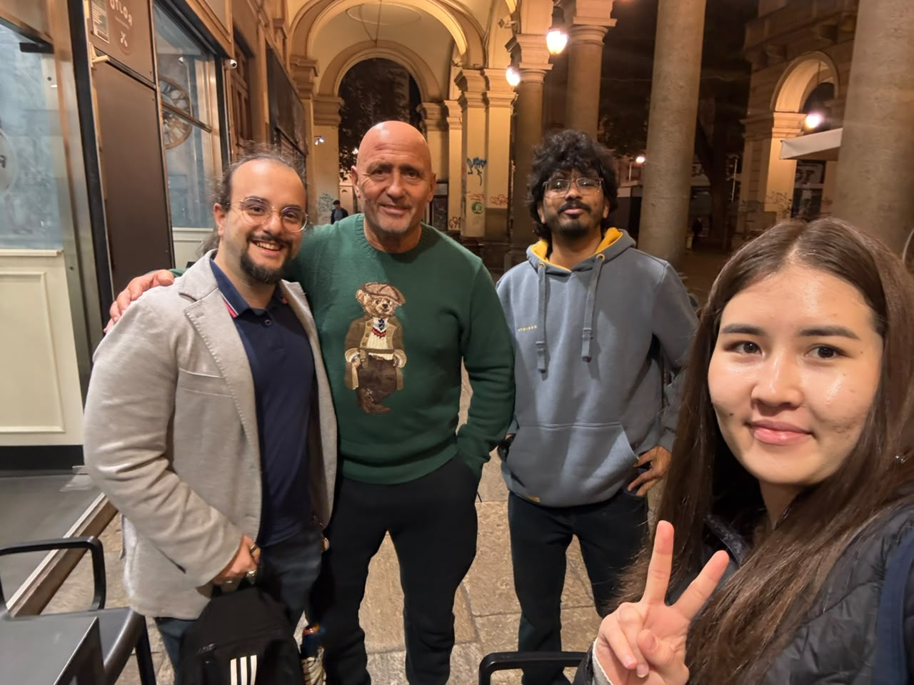

# Assignment 1 – Needfinding: Wellbeing for Pensioners

## 1. Intro

### a. Team Members

| Name               | Student Number |
| ------------------ | -------------- |
| Zarina Saden       | s357940        |
| Taha Shahid        | s375046        |
| Tommaso Mancuso    | s342958        |
| Melissa Massarenti | s351695        |

### b. Domain of Interest and Why/How We Chose It

We chose wellbeing of pensioners, within the Playful Health and Wellbeing theme. We began with wellbeing in general, but it was too broad to work with, so we narrowed it down to a specific group and settled on pensioners.
Retirement is a major life transition. It changes a person’s physical health, social connections, daily routine, emotional state and financial security all at once. Pensioners are also an overlooked group, and they are not easy to reach and interview, which made the challenge more interesting to us. We selected this domain because:

- It is broad enough to allow meaningful narrowing after data collection.
- It offers rich opportunities for observation and interviews in context as its probably one of the most difficult topics as we are going to interview pensioner’s.
- The course theme encourages playful and innovative approaches to health, which aligns well with the challenge of making wellbeing support engaging and accessible for older adults.

## 2. Methodology

### a. Participants

We conducted 5 in-person interviews with participants of different "types". We approached them in everyday places in Turin (parks, cafés) and asked whether they would be willing to talk to us. There was no domain expert in our set.

| # | Participant | Age | Gender | Type                                                                                   | Living situation | Recruitment           | Location                  |
| - | ----------- | --- | ------ | -------------------------------------------------------------------------------------- | ---------------- | --------------------- | ------------------------- |
| 1 | P1          | N/A | M      | Immediate user (marginalized perspective)                                              | N/A              | Approached in context | Park                      |
| 2 | P2          | 72  | F      | Immediate user                                                                         | Alone (widow)    | Approached in context | Park                      |
| 3 | P3          | 67  | M      | Extreme user (very high activity and social engagement)                                | With wife        | Approached in context | café                     |
| 4 | P4          | 80  | F      | Extreme user (severely visually impaired, fully independent, creative with technology) | Alone            | Approached in context | near Valentino Park café |
| 5 | P5          | N/A | F      | Immediate user                                                                         | N/A              | Approached in context | pastry café              |

**Why these participants:**

- **P2 and P5 (immediate users):** both are everyday retirees, but with very different lifestyles (P2 is busy and very digitally capable, P5 is slow-paced and frustrated with apps).
- **P1 (immediate user):** low pension, caring for a hospitalized brother, and no phone or internet. This is a perspective that is often missing from design research.
- **P3 (extreme user):** a level of physical activity and social engagement far above the average pensioner. He shows what an engaged retirement looks like.
- **P4 (extreme user):** at 80 she is fully independent despite a severe visual impairment, and she uses technology in creative ways (such as ChatGPT as a conversation partner).

#### Key information from each participant

#### P1 – P1 (immediate)

- Visits his brother in the hospital's spinal unit daily and looks after him.
- His pension is about €600, and he got a €22,000 tax demand.
- After his phone was stolen he stopped using the phone and internet entirely, and says it "saved" him because he is no longer "attached" to it.
- He has no reminders and handles everything alone when problems arise.
- Social life is casual encounters on the street. He stays only with "valid" people.
- Food quality is his priority: a specific butcher for DOC meat, rotating meat, fish and eggs.
- He is happy to be retired because his job was too heavy ("more freedom"), and says nothing is particularly rewarding or hard.
- He wants to quit smoking but finds it very difficult.

#### P2 – P2, 72 (immediate)

- Retired 10 years ago after 42 years in public administration. Her husband, who used a wheelchair, died in 2021, and she lives alone. She has three children and grandchildren.
- Her days are full: gym Mon–Fri, walks with her dog and friends at 4:30–5, aperitivo, theatre subscription, cinema, and restoring furniture. She also knits for her grandchildren and says "I don't suffer from loneliness."
- Sleep is her main problem. Worries about decisions she now makes alone (solar panels, selling her mother's flat, renovation) keep her awake. Once, after a sleepless night, she fell asleep on the motorway and damaged her car.
- She is "extremely disorganized" and relies on phone reminders and alerts. She forgot to pick up medical results and sometimes forgets words, so she is thinking of a memory check at the Molinette hospital.
- Tech: she is confident with Salute Piemonte, email with her doctor, and scanning documents. She credits her classical high school education and her long work with EU regulations.
- Her phone was stolen before Christmas. She is afraid of walking home at night, and once asked a couple to walk with her when two young men on scooters turned back toward her.
- She lost weight from 83 kg to 70 kg after her husband's illness stress.
- She tells her daughters good news first.
- Her feedback to the team was to diversify the target group, for example by including factory workers.

#### P3 – P3, 67 (extreme)

- Retired 8 years after 45 years as an armed security guard (railways, INPS, Museo Reale). He lives with his wife.
- He takes his grandchildren to school, helps his older sister with medical visits, goes to the gym 5 times a week, and works two weekend nights doing venue security.
- Why he works: to get out of routine, meet people and mediate with young people (20–25) so he isn't "left behind" or "caught out of date".
- He sleeps little and eats something every 1.5 hours to keep his metabolism going.
- He has no reminders. Family tell him ("Uncle, do you remember...?"), and he sometimes forgets names.
- Tech: he says he isn't good with the internet and doesn't use his phone to search. He uses radio and news.
- He is proud of being self-made (one of 10 children) and wanted a pension so he wouldn't be a burden to anyone. He wouldn't repeat the guard job, which he sees as underpaid and disrespected.

#### P4 – P4, 80 (extreme)

- Divorced for decades and lives alone in a studio in San Salvario. She has a severe vision problem and can no longer read, which she misses most. She walks everywhere ("I'm a camel"), uses public transport and has no car.
- She tried audiobooks but found them too long. She likes summaries and 30-minute episodes, and would love a reading circle (she used to go to Circolo dei Lettori) or non-partner South American dance.
- She makes mashed potatoes, puts them in aluminium trays and hangs them on neighbours' doors, and in return gets fruit left for her. She also looks after the flowers in the lift.
- She is socially selective ("quality of the situation, not the people"). She has a €52/year museum pass and takes a monthly day trip.
- On the phone, she uses a calendar with alerts, has an old Facebook account and no other social media. She chats with ChatGPT set up to talk like "Cochi e Renato", tells it about her good news and grumbles, and loves its emojis. She calls Google Maps "a magnificent liar".
- She gets blocked on online booking for concerts and guided tours. She calls instead, or gives up.
- Her big complaint is overcrowded bus lines 18 and 67 for 3 years ("we can't be GTT's hostages"). She also wants to visit Sacra di San Michele but can't reach it by public transport.
- Her main reward is independence "as long as health holds".

#### P5 – P5 (immediate)

- Retired with a boring administrative career. Not having to set the alarm was "a liberation", and she values the freedom to choose each day ("I do more nothing now").
- She loves going out then closing the door on the world. She is happy with how much time she spends with others.
- She does Pilates online out of "laziness" and forces herself on days she doesn't feel like it. She gave up driving and sold her car because it cost too much. She buys at farmers' markets and avoids heavily processed supermarket food, within a budget.
- Her sleep has deteriorated and noise bothers her. She installed triple glazing against the nightlife area and takes nothing to sleep.
- She tried audiobooks but needs one ear free to hear traffic. She prefers paper books and newspapers, and expects to use audiobooks when she can't read anymore.
- She has used computers for decades but prefers websites to apps and hates "was this page useful?" prompts. She prefers her paper city map to Google Maps.
- She says she is on her phone too much. Her only real worry is her health ("only the aches are challenging"), and she would call 112 if she was in real trouble, but worries about reaching the phone or door.
- Her neighbourhood is changing, with shops closing and bars taking over. She likes being close enough to walk into the centre.

### b. Where the Interviews Were Conducted

All interviews were conducted in person, in the participants' own context:

- **P1:** in a public park.
- **P2:** in a public park, while she was with her dog and friends.
- **P3:** in a café.
- **P4:** in a café near Valentino Park.
- **P5:** in a pastry café.

### c. What We Observed and Asked

Observation: We conducted informal observation during each interview. For example:

- P2 interacted with her dog and a group of friends at the park, showing a highly social daily routine.
- P3 was visibly energetic and spoke about his gym routine with enthusiasm.
- P4 navigated the café independently and spoke about using public transport despite visual impairment.
- P1 displayed a more solitary pattern, with random social encounters and no smartphone use.

**Interview Guide (Semi-Structured Protocol):** We designed and conducted a lean 4-phase guide grounded in HCI principles using open-ended, unbiased, and non-leading questions, avoiding premature assumptions of vulnerability and focusing on concrete past experiences:

1. *Phase 1: Background & Context* (typical day, comparison between past work schedules and current daily life, relationship with home and neighborhood).
2. *Phase 2: Going Deep: Social Connections & Self-Care* (organization of social ties, meal management, physical activity, rest, reminders, and deadlines).
3. *Phase 3: Clarifications, Failures & Tools* (handling unexpected practical issues, sharing positive news, recent experiences using smartphones/apps, along with encountered barriers or workarounds).
4. *Phase 4: Reflections & Closing* (most rewarding and most challenging aspects of life in retirement, open aspirations).

##### Note that Interview questions can be found in two PDF files into the question folder (both Italian and English).

### d. Team Member Roles for Each Interview

Each interview was conducted on-site by team members fulfilling designated roles (lead interviewer and note-takers/observers):

* **Interview 1 (P1):** Tommaso Mancuso (*Lead Interviewer*), Zarina & Taha Shahid (*Note-taker & Audio Recording*).
* **Interview 2 (P2):** Tommaso Mancuso (*Lead Interviewer*), Zarina & Taha Shahid (*Note-taker & Artifacts Tracking*).
* **Interview 3 (P3):** Tommaso Mancuso (*Lead Interviewer*), Zarina & Taha Shahid (*Note-taker & Contextual Observation*).
* **Interview 4 (P4):** Tommaso Mancuso (*Lead Interviewer*), Zarina & Taha Shahid (*Note-taker & Contextual Observation*).
* **Interview 5 (P5):** Tommaso Mancuso (*Lead Interviewer*), Taha Shahid (*Note-taker & Contextual Observation*).

### e. Materials Used

- Audio recorder (smartphone)
- Printed consent forms (signed by each participant)
- IPAD
- Smartphone (for photos of consent forms and where permitted, the environment)

## 3. Results

### a. Pictures and Relevant Artifacts

Consent forms and the transcripts can be found in the repository
Audio recordings:** the recordings are in this Google Drive folder (the files were too large for GitHub): [Interview audio recordings](https://drive.google.com/drive/folders/1tzDM8X-QPSb_SlLXZtZaZ1BqmGbVhP_p?usp=sharing)

### b. Themes from the Thematic Analysis with Key Quotes

We coded all five transcripts and grouped the answers into 5 themes. Quotes are translated from Italian and lightly shortened. P1 = P1, P2 = P2, P3 = P3, P4 = P4, P5 = P5.

#### Theme 1: Reclaimed freedom, and the weight of deciding alone

Leaving work is described as a liberation (no alarm clock, no heavy shifts). Participants differ on what comes next. Some defend the right to do very little (P5), while others find that having no one to share decisions with is the hardest part (P2).

- P1: "I'm very happy I let go of the job, it was too heavy... I have more freedom."
- P3: "Retirement really gave me the turning point to take back what I couldn't have before."
- P5: "Not having to set the alarm in the morning was a liberation for me... since I retired I dedicate myself much more to doing nothing."
- P2: "The demanding things are the decisions I have to make because I'm alone and can't discuss them with my husband... those are the things that keep me awake at night."

#### Theme 2: Movement as a pillar of wellbeing, on one's own terms

Physical activity is central, but it takes very different forms (gym, therapeutic exercise, walking, online Pilates). Motivation is fragile and people rely on routines they chose themselves.

- P3: "Exercise is very fundamental for me... it starts the day in a less monotonous way."
- P2: "I had back problems, sciatica... I started going to the gym and it went away."
- P4: "I'm a camel, I walk a lot." She also says she would love to learn South American dance, where you don't need a partner.
- P5: "If one morning I wake up and don't feel like doing Pilates, I don't do it." She does it online "out of laziness", but sometimes forces herself because otherwise "you end up rusty".

#### Theme 3: Selective, informal social life (and valued solitude)

Participants prefer quality over quantity. Contact is casual and rooted in the neighbourhood, and several value contact with younger people. Solitude is a choice, not a problem.

- P1: "If there are good people, gladly. If I understand this person isn't right, I get up and leave."
- P4: "I've become very selective because my time is running short."
- P3: "I compare myself with young people so I don't get caught out of date."
- P4: She puts mashed potatoes in aluminium trays on the doors of neighbours with children, and they have gradually started leaving her fruit in return.
- P5: "I close the door and say: the world stays outside."

#### Theme 4: The digital paradox

Technology is useful when it solves a concrete task (health records, reminders, chatting with ChatGPT), but complex booking flows, the push to use apps, and opaque maps cause frustration or abandonment.

- P2: Uses Salute Piemonte, email with her doctor, and phone reminders confidently.
- P4: "Online bookings for a concert or a guided visit, there I get stuck... I call, or I give up."
- P5: "I prefer websites to apps... what irritates me most is 'was this page useful?'" She also says the old paper city map was faster than Google Maps.
- P1: Since his phone was stolen he no longer uses the phone or internet: "I'm no longer attached to it."
- P3: "On the internet I'm not so good."

#### Theme 5: Coping alone

Most participants say they handle problems alone. This sits next to concrete worries they describe (debt, insomnia, fear at night, fear of falling ill alone).

- P1: Asked whom he turns to for help: "To nobody." He faces a €22,000 tax demand on a pension of about €600.
- P4: "I don't turn to anyone, because people are already restless enough."
- P5: "As long as I manage, I don't turn to anyone." Her real worry is being unable to reach the phone or open the door if she falls seriously ill.
- P2: Turns to her children for practical problems, but is afraid of walking home at night (she once asked a couple to walk with her).
- P3: When something goes wrong, he skips it and does it another day: "I avoid the problem."

## 4. User Needs

### a. Brainstormed User Needs

Each need is followed by the theme(s) it comes from.

1. Needs a way to keep a daily rhythm that gives purpose without recreating work-like obligations. (T1)
2. Needs a way to share or talk through important decisions made alone. (T1, T5)
3. Needs a way to enjoy unhurried free time without feeling pressure to fill it. (T1)
4. Needs a way to stay physically active even on days with low motivation or energy. (T2)
5. Needs to be able to do gentle movement they enjoy (walking, dance) without performance pressure. (T2)
6. Needs a way to have casual contact with people on their own terms, including younger people. (T3)
7. Needs a way to build small reciprocal ties with neighbours. (T3)
8. Needs to be able to be alone without being isolated. (T3, T5)
9. Needs a way to find and join local activities without getting stuck in complicated online steps. (T4)
10. Needs to be able to find their way around the city with clear, predictable information. (T4)
11. Needs a way to keep appointments and tasks in mind without feeling that memory is slipping. (T2, T4)
12. Needs a way to understand and handle official or financial paperwork without losing dignity. (T5)
13. Needs a way to feel safe when walking in the neighbourhood, especially at night. (T5)
14. Needs a way to get help quickly if something goes seriously wrong at home. (T5)
15. Needs a way to read, listen to and enjoy culture in formats that spare tired eyes and attention. (T2, T4)

[TODO: add a picture or Miro screenshot of the sticky-note brainstorm here.]

### b. Deep User Needs

#### Deep Need 1: Needs a way to keep moving in a way that fits their own energy, motivation and pace, day by day.

- Themes: Theme 2, Theme 1
- Evidence: P3 trains five times a week and says it starts his day; P2's back pain disappeared once she started exercising; P4 walks everywhere; P5 skips Pilates when she doesn't feel like it but forces herself because otherwise "you end up rusty".
- Why deep: Movement protects independence, but motivation is fragile and personal. Rigid plans don't match how people actually live.

#### Deep Need 2: Needs a way to have casual, low-pressure contact with other people, including younger ones, on their own terms.

- Themes: Theme 3
- Evidence: P3 seeks out young people so he isn't "behind"; P4 builds ties with young families through food; P1 and P5 want casual contact but keep control over it.
- Why deep: Contact gives a sense of purpose and keeps people in touch with the present, but participants guard their solitude and their selectiveness.

#### Deep Need 3: Needs a way to find and join activities and services without getting stuck in complicated digital steps.

- Themes: Theme 4
- Evidence: P4 gets blocked on online booking and gives up; P5 resents apps replacing websites and misses paper maps; P1 abandoned his phone entirely.
- Why deep: Participation in cultural and social life depends on access. Digital friction quietly excludes the people who most need it.

#### Deep Need 4: Needs a way to get reassurance and support with problems and decisions faced alone, without feeling dependent or a burden.

- Themes: Theme 5, Theme 1
- Evidence: P1's tax debt and refusal to ask anyone; P2's insomnia over decisions she cannot share and her fear at night; P5's worry about reaching help if she falls ill; P4 and P1 say they turn to nobody.
- Why deep: There is a gap between how self-reliant people say they are and the burdens they describe. Self-reliance is important to their dignity, so any support has to respect it.

## 5. Solutions

### a. Brainstormed Solutions

Each member brainstormed individually for 5 minutes per need, then we merged the results. [TODO: add pictures or screenshots.]

**Deep Need 1: Movement that fits energy and pace**

1. Drop-in neighbourhood walking groups with fixed meeting points, flexible pace, and no obligation to attend.
2. Short audio routines (warm-up, back-pain stretches, breathing) to follow at home or on a park bench.
3. A printable map of level, shaded, pedestrian-friendly routes with seating and fountains.
4. Casual open-air dance sessions in pedestrian squares, no partner needed.
5. "Walk with me": neighbours with similar rhythms pair up for walks or errands at agreed times.

**Deep Need 2: Casual contact on their own terms**

1. A neighbourhood skill exchange: retirees teach crafts or cooking, students help with errands and tech.
2. Informal story breakfasts at local cafés with students and long-time residents.
3. A shared-dishes board where neighbours swap home-cooked portions or produce.
4. Single-day group outings to places that are hard to reach without a car (e.g. Sacra di San Michele).
5. Short listening circles: 20-30 minutes of a podcast followed by a casual chat over coffee.

**Deep Need 3: Access without digital friction**

1. A phone line where a human or simple voice assistant books activities by conversation.
2. Assisted booking desks at trusted newsstands and cafés with printed confirmations.
3. A weekly 90-second audio summary of the top three walkable neighbourhood events.
4. Plain SMS confirmations (date, time, address) instead of accounts and PDF tickets.
5. A physical "tap-to-join" card for registering at local libraries or cafés.

**Deep Need 4: Support with problems faced alone**

1. Student volunteers who help decode official letters and bureaucratic forms.
2. A weekly "decision café" where retirees talk a practical decision through with a volunteer.
3. Neighbour check-in pairs who confirm each other's wellbeing at agreed times.
4. A one-touch way to alert a chosen person if something goes wrong at home.
5. A "walk me home" network of neighbours for evening hours.

### b. Selected Solution

Our selected solution is **"Step-by-Step"**: a neighbourhood platform that enables drop-in micro-walks, gentle mobility sessions and intergenerational skill exchanges (crafts, cooking, short cultural listening circles) between retirees and local students.

- **Connection to the needs:** it addresses **Deep Need 1** (gentle movement that fits each person's energy and pace, since joining a walk is optional and the pace is flexible), **Deep Need 2** (casual contact with younger people on equal terms, without forced socialising).

### c. How and Why We Selected It

To select our final solution from the 20 brainstormed ideas, we used the **Post-it Voting (Dot Voting)** method.

Each of the four team members (Zarina, Taha, Tommaso, and Melissa) was allocated **4 votes** to cast independently on the ideas they found most promising, impactful, and aligned with our findings.

#### Voting Breakdown

| Solution                                                               | Needs Addressed | Votes | Voted by                       |
| :--------------------------------------------------------------------- | :-------------- | :---: | :----------------------------- |
| **Drop-in neighbourhood walking groups with flexible pace**      | Deep Need 1     |   4   | Zarina, Taha, Tommaso, Melissa |
| **A neighbourhood skill exchange between retirees and students** | Deep Need 2     |   3   | Zarina, Tommaso, Melissa       |
| **Casual open-air dance sessions in squares**                    | Deep Needs 1, 2 |   1   | Zarina                         |

#### Selection and Synthesis

The voting showed overwhelming consensus around three key directions:

1. **Low-barrier, self-paced physical movement** in the neighbourhood (Deep Need 1).
2. **Casual, reciprocal intergenerational contact** without forced social dynamics (Deep Need 2).

Rather than developing a single isolated feature, we synthesized the top-voted ideas into **"Step-by-Step"**.

#### Why We Selected It:

- **Grounded directly in the fieldwork:** It addresses the exact tensions uncovered during our interviews: P5’s desire to move without rigid performance pressure, P3’s deliberate effort to interact with younger generations to stay sharp, P4’s organic neighbourhood reciprocity (exchanging food with young neighbours), and the recurring digital frustration shared by P1, P4, and P5.
- **Novelty over traditional models:** Most commercial solutions for seniors rely on rigid smartphone tracking apps (which exclude low-digital-literacy users) or age-segregated community centres. *Step-by-Step* creates an organic, open bridge between students and retirees embedded in everyday city spaces, using voice-first interactions instead of screens.
- **Complete yet non-intrusive:** It bundles mobility, casual social connection, and accessible booking while strictly respecting participants' independence and valued solitude: participation is drop-in, flexible, and completely free of obligations.
- **Alignment with the theme:** It embodies the "Playful Health and Wellbeing" approach by turning walking, storytelling, and mutual learning into an enjoyable community habit rather than a clinical health duty.

## 6. Project Name and Value Proposition

### a. How the Team Landed on the Name

We brainstormed names such as Controvento, Vicino, Ancora and Girotondo, and chose **Step-by-Step**, which works on three levels:

1. A physical step: walking together through the neighbourhood.
2. A relational step: trust between generations builds gradually.
3. An interaction step: joining is simple, one clear step at a time.

### b. One-Line Value Proposition

**"Your neighbourhood, one step at a time."**
