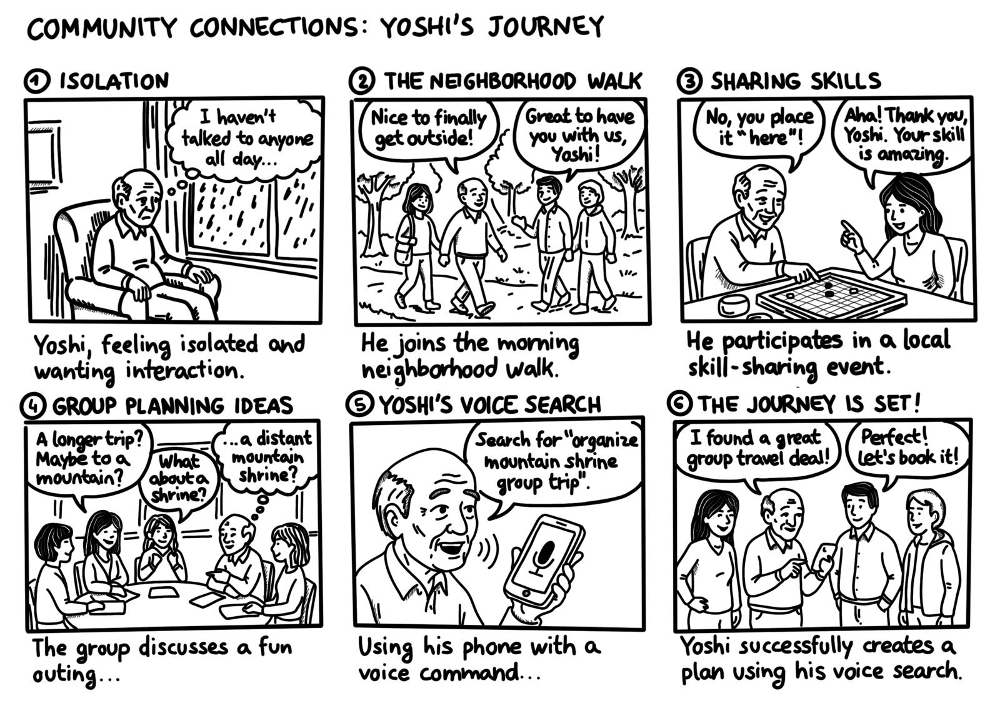

# Assignment 2: Storyboard & Paper Prototypes

---

## 1. Intro

### 1.a Project Title and Team Members

**Project title:** Wellbeing for Pensioners

| Name               | Student Number |
| ------------------ | -------------- |
| Zarina Saden       | s357940        |
| Taha Shahid        | s375046        |
| Tommaso Mancuso    | s342958        |
| Melissa Massarenti | s351695        |

### 1.b Value Proposition
An application thath helps pensioners by keeping them active and connected by letting them go into gentle neighbourhood walks and casual skill exchange, at their own pace, without complications.

### 1.c Problem/Solution Overview

**Problem:**
Problem: Retirement brings freedom, but it also removes the structure that used to keep people moving and in contact with others. In our needfinding interviews with five pensioners in Turin, we saw two recurring tensions:

1. Movement depends on fragile motivation. All participants see physical activity as essential to staying independent (gym, walking, Pilates), but motivation varies from day to day, and rigid plans don't fit how they actually live (e.g. P5 skips Pilates when she doesn't feel like it, but fears "ending up rusty").
2. Social contact must stay on their own terms. Participants value casual, selective contact, especially with younger people (P3 seeks out young people so he isn't "caught out of date"; P4 exchanges food with young neighbours), but they also protect their solitude and avoid forced socialising.
3. On top of this, existing solutions often rely on complex apps or online booking, which many older adults find frustrating or give up on (P4 gets stuck on online bookings; P1 no longer uses a phone at all).

**Solution:**

Step-by-Step is a neighbourhood platform that helps retirees by:

1.Walks and gentle mobility sessions at fixed meeting points, with flexible pace and no commitment to attend.

2.Intergenerational skill exchanges, such as crafts, cooking or short listening circles, where retirees and students both teach and learn.

3. Joining is meant to be simple and accessible. The playful side comes from turning walking, storytelling and mutual learning into an enjoyable community habit rather than a health duty, while fully respecting each person's independence and pace.

## 2. Tasks and Storyboard

### 2.a Tasks

#### Task 1: The Simple Task
Goal: Join a spontaneous, low commitment neighborhood micro-walk to get some gentle exercise and fresh air.

#### Task 2: The Moderate Task
Goal: Participate in an intergenerational skill exchange (teaching a craft/cooking in exchange for a small errand or tech help).

#### Task 3: The Complex Task
Goal: Organize and participate in a single-day group outing to a location that is hard to reach by public transport (e.g., Sagra di San Michele) use voice for searching to make it simple and easier.

### 2.b Storyboard

**Why we chose it:**
We selected this scenario because it follows a single protagonist on a continuous, realistic journey of social reconnection and community engagement. It effectively weaves together all three tasks in a natural progression: starting from a low-barrier micro-walk (Task 1), moving to an intimate skill-sharing session (Task 2), and culminating in a collaborative, voice-assisted plan for a complex group outing (Task 3).

**Strengths:**
- **Human-centric focus:** It centers on user behavior, emotional needs, and real-life interactions rather than getting bogged down in complex user interface (UI) details.
- **Clear progression:** Demonstrates a believable, motivating transition from initial isolation to active community participation.
- **Effective use of voice interaction:** Clearly shows how voice search removes friction when planning a complex trip.

**Weaknesses:**
- **Panel density:** Compressing three distinct tasks and a multi-step narrative into 6 panels requires keeping background contexts relatively simple.
- **Single perspective:** Focusing primarily on one main character's viewpoint limits showing how multiple peers interact simultaneously within the system.

**How well it achieves the identified goal/user need:**
The storyboard directly addresses the core needs identified during the needfinding phase—specifically loneliness, lack of physical motivation, and the intimidation factor of traditional digital interfaces. By showcasing natural social hooks and voice-driven accessibility, it proves how our solution can successfully empower elderly users to achieve all three defined tasks.

---

## 3. Modalities Exploration

### 3.a Overview of the Alternatives Considered

| # | Modality / Alternative | Short description | Pros | Cons |
|---|------------------------|-------------------|------|------|
| 1 | Touch(Smartphone app)|App with with comfortable and creative UI/UX | portable;familiar | needs to be designed carefully  |
| 2 | Voice assistant | Talk to the app  | easy to use  | Fails in noisy streets; privacy when talking to public   |

### 3.b Selected Alternatives and Motivation

**Alternative A — [Touch (Smartphone app)]:**
Most of the pensioners we interviewed already use a smartphone every day, so the app feels familiar. It’s portable and can show maps, meeting points and who’s joining a walk

**Alternative B — [Voice assistant]:**
It’s easier for users with poor eyesight or low tech confidence because there’s no small text or menus. It also works hands-free while walking.

---

## 4. Paper Prototype #1 — Smartphone App (Touch) + Voice Assistant

### 4.a High-Level Flow of the Screens

**Touch (smartphone app)**

1. **Home:** Greeting ("Good morning, Anna"), an "Ask: Is there a walk coming soon?" voice button, a "Starting soon near you" card (Riverside Loop, Fountain, Valentino Park, 10:30, 2 km, easy pace), a shake-the-phone shortcut, and "More to do" cards for Skill exchange and Day trips. The user can open a walk, ask by voice, or start another task.
2. **Walk details:** Map, place, start, length, pace and "6 people are going". The user can tap Read it to me, Join this walk, or hold the phone to the ear to hear the details.
3. **You're going:** Confirmation ("See you at 10:30") with a summary card and reminder. The user can tap Show me the way or Cancel my place.
4. **Getting there:** Map, "120 m ahead", a hint to look for the red Step-by-Step sign, and a buzz on arrival. The user can tap Check in or tap phones with the organiser.
5. **Checked in:** Live step count, "Walking with you" list and "Slow down or leave whenever you like". The user can tap End my walk.
6. **Walk complete:** Steps added to the footprint trail and a five-face experience rating. The user can tap Back to home.
7. **Skill exchange (pensioner):** I can teach / I need help toggle, search and topics (Cooking, Craft, Tech help, Knitting). The user taps See who's interested.
8. **Interested students:** List of students who want to learn cooking (Taha, 26, can help with mobile; Tommy, 39, can help with cooking). The user picks one.
9. **Send a request:** What you teach (fresh pasta), what the student helps with (smartphone), three time slots, a place field and Send request.
10. **Request accepted:** "Taha said yes" with date, time, place and a message from Taha. The user can tap Call or We've met – confirm.
11. **Thank-you screen:** "Thank you, Anna" with a Grazie badge and Back to home.
12. **Student side (browse):** Join as student (verify university email), then Learn from retirees (filters All, Cooking, Craft, Stories), then Offer details (Fresh Pasta by Anna, 74, about 30 min, what she wants in return).
13. **Student side (request):** Ask Anna (choose what you help with, pick a time, short hello), Request sent (waiting, See Anna's reply, withdraw), then "It's on" with a We've met – confirm button leading to the thank-you and badge screen.
14. **Day trips – search:** "Where would you like to go?", a tap-and-say button, a type-a-place field and "Popular with neighbours".
15. **Voice search listening:** The phrase "trip to Parco Dora next Saturday" is captured. The user taps Show results.
16. **Results:** Options with transport (Parco Dora by minibus from Porta Nuova, Superga by rack railway, Avigliana Lake by train and a short walk).
17. **Plan the day:** Sacra di San Michele, date chips, leave 9:15, back about 19:00, meeting point and group size. The user taps Next: invite friends.
18. **Invite friends:** Checklist of past-walk neighbours and Send 3 invitations.
19. **Trip confirmed:** "The trip is on!", who's coming (6/6), date, time, address and Back to home.

**Voice assistant**

20. **Voice home:** "Good morning Anna. What would you like to do today?" with starter phrases (Is there a walk? / I'd like to teach / get help / Plan a trip) and a microphone and ear bar that is the same on every screen.
21. **Listening:** The microphone is active and the caption shows what the user said ("Is there a walk this morning?").
22. **Task 1 – Walk:** Step finds Riverside Loop, shows a map and asks "Shall I tell the group you're coming?" The user answers No / Yes please.
23. **Task 1 – Joined:** "You're on the list", with an offer of directions.
24. **Task 2 – Skill exchange:** The user says "I'd like to teach", Step names Taha with a profile card, the user picks a slot (A / B), and "Invitation sent" appears.
25. **Task 3 – Group outing:** The user says "Plan a trip to…", Step finds a shared minibus, asks "Shall I invite…?", the user says Yes, and "Invitation sent" appears.
26. **Noisy-street fallback:** "It's a bit noisy, try again, or show me the choices on screen." Buttons are Show me on screen and Try speaking again.

### 4.b Connection to the Storyboard and the Three Tasks

**Storyboard:**
The storyboard follows one protagonist from a first low-pressure walk, to a skill-sharing session, to a voice-assisted group outing.
- The first moment (the micro-walk) is represented by screens 1–6 (touch) and 20–23 (voice).
- The second moment (the intimate skill exchange) is represented by screens 7–13 (touch) and 24 (voice).
- The third moment (planning a hard-to-reach outing by voice) is represented by screens 14–19 (touch, starting with voice search) and 25–26 (voice).

**Tasks:**
- **Simple task – Join a micro-walk:** Touch: Home (1) → Walk details (2) → You're going (3) → Getting there (4) → Checked in (5) → Walk complete (6). Voice: Voice home (20) → Listening (21) → Walk (22) → Joined (23).
- **Moderate task – Skill exchange (teach cooking, get tech help):** Touch (pensioner): Skill exchange (7) → Interested students (8) → Send a request (9) → Request accepted (10) → Thank-you (11). Touch (student side): Browse and offer details (12) → Request and confirmation (13). Voice: Skill exchange (24).
- **Complex task – Group outing to a hard-to-reach place (Sacra di San Michele):** Touch: Day trips search (14) → Voice search listening (15) → Results (16) → Plan the day (17) → Invite friends (18) → Trip confirmed (19). Voice: Group outing (25), with the noisy-street fallback (26) if speech fails.

---

## 5. Paper Prototype #2 — Smartphone App (Touch) + Voice Assistant

### 5.a High-Level Flow of the Screens

**Touch (smartphone app)**

Every screen has Back, a Menu button and a title. Main screens have a bottom bar: Home, Walks, Skills, Trips, Me.

1. **Walks nearby:** Search with active filters (slow pace, anytime, under 1 km), a walk card (today 10:00, Parco del Valentino, slow, 40 min, 6 joining), See walk and Propose a walk.
2. **Walk details:** Map, when, pace, length, meeting point and "6 people joining". The user can tap Join this walk or Who's coming.
3. **Who's coming:** First names and pace only, with Call organiser and Back to walk.
4. **You're in:** "No commitment, you can cancel any time", a reminder at 9:15, and Show me the way, Cancel my spot or Home.
5. **Cancel spot:** "Are you sure?" with Keep my plan and Yes, cancel.
6. **Directions:** "5 min to meeting point", a map, I've arrived and I'm lost – help.
7. **Check-in:** "You made it", a large check-in button ("Say hello to the organiser") and I need help.
8. **Walking:** Live step count, footprint trail, Finish walk and I need help.
9. **Walk completed:** "Well done, Maria!", steps and time, a pace rating (Great / Okay / Too hard), Next – swap a skill and Home.
10. **Propose a walk / Walk published:** Meeting point search with popular places, date, time and pace, then Publish walk. The confirmation links to Home and My Plans.
11. **Help & Safety:** Emergency 112, trusted contact (Anna, daughter), Call my contact, Call 112 and How Step works.
12. **Skill exchange main:** I can teach, I need help, My skills and a short disclaimer.
13. **Choose topic:** Search plus predefined topics (Cooking, Crafts, Tech help, Errands) or Add + for a custom one.
14. **Matching students:** "2 people near you" with Giulia, 22 (wants to learn cooking) or Marco, 24 (can help with phones), free times and Send request.
15. **Request sent:** "Request sent to Giulia", "No commitment", and how she will reply (email, SMS or in-app).
16. **Request confirmed:** "Giulia said yes!" with when, where, what, a map and a reminder. The user can tap We've met – confirm, Message Giulia or Cancel exchange.
17. **Message:** Ready-made replies ("I'm on my way", "Running 10 min late") or call instead, with no typing. The help flow reuses it.
18. **Student side (requests):** Home ("Ciao Giulia", next meeting, requests with Accept / Decline), New request (Maria's message, Yes suggest a time / No thanks / Call Maria), Say yes (day, time, place) and Decline ("Say no kindly" with ready-made replies).
19. **Student side (learn):** Request to learn (topic, message, when you're free, what you'll help with), Request sent, and Confirmed meeting (when, where, map, Done, Cancel).
20. **Group outings main:** "Places that are difficult to reach" (Sacra di San Michele, Basilica di Superga) and Suggest a place.
21. **Suggest a place:** Place and optional reason, then Send suggestion and a thank-you screen.
22. **Outing details:** Shared minibus, cost, departure, return time, walking difficulty, a disclaimer and Organise with friends.
23. **Pick a date:** "Each day has a minibus with 8 seats", with large buttons (Sat 21 Nov, Sun 22 Nov, Sat 28 Nov).
24. **Invite friends / Bump phones:** Checklist of past-walk participants, Send invitations, or Bump phone to invite ("Hold your phone back to back…").
25. **Waiting for answers:** "3 of 6 said yes, confirmed when 5 join", a Yes / Waiting list, Home and Cancel outing.
26. **My plans:** The outing card with its status, other plans and Past activities.
27. **Outing day:** "Minibus leaves at 8:00, bay 3", a map, I'm here – Check in and Help.
28. **On the trip:** "Location shared with Anna until the trip's end", a map, return time, End trip and Help.
29. **Outing done:** Badge, "Welcome home, Maria", an experience rating (Great / OK / Too tiring) and Home.

**Voice assistant**

Every voice screen has a microphone circle, a "Step says" bubble, live captions and "Say: …" chips.

30. **Find a walk (Task 1):** "There's a walk today at 10:00… 4 people are coming. Shall I add you?" with when, pace, length and meeting point. Chips: Yes / No / Repeat.
31. **Walk booked:** "You're in!" and "Would you like directions?" Chips: Yes, directions / Not now.
32. **Directions:** "Walk down Via Nizza… Tell me when you get there," with a map. Chips: I'm here / Repeat / I'm lost.
33. **Checked in:** "I've told Luca, the walk leader, that you're here. Enjoy the walk!" Chips: Thank you / Help.
34. **Skill exchange main (Task 2):** "Would you like to teach or get help from a student?" Chips: I'd like to teach / I'd like some help / Emergency help / Menu.
35. **Teaching topic and matching student:** "What do you like to teach?" (Cooking / Knitting / Something else), then "I've found Giulia, a student who lives 5 minutes away. Shall I ask?" Chips: Yes, ask her / Tell me more / Not now.
36. **Request sent and confirmed:** "I'll let you know as soon as she confirms." Her reply shows as Yes or No. Then "She said yes" with when, where, what and a map. Chips: We met (leads to thank-you) / Not yet (ask someone else or go home).
37. **Plan an outing (Task 3):** "Where would you like to go?" with a note that a minibus takes up to 8 people. Chips: place names / Suggest a new place. Then "Which day suits you?" with date chips.
38. **Invite friends:** "Who should I invite? I can ask your walking group." Chips: Whole group / Name of people, plus a tip to bump phones to invite.
39. **Waiting and confirmed:** "I've invited the group. 3 of 6 confirmed." (Remind them / Cancel outing), then "5 people said yes." (Guide me on the outing day / Thanks).
40. **Outing day:** "Today is your outing day, here are the details," with a map. Chips: I'm at the bus / I'm running late. The On the trip and Outing done screens are the same as touch, with voice control.
